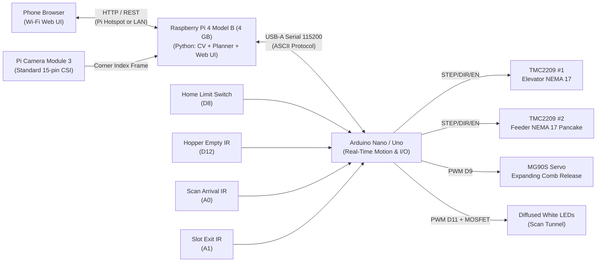
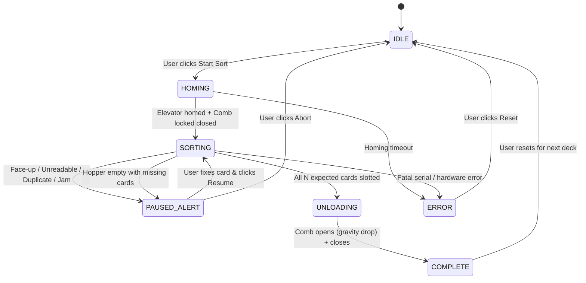

# System Architecture & Electrical Specification

## 1. High-Level System Overview

The shuffler splits responsibility cleanly across two processors so that **computer vision + phone UX** never interfere with **microsecond-accurate stepper timing**:

- **Raspberry Pi 4 Model B (4 GB RAM, Python):** Runs the phone-facing Wi-Fi Web UI (FastAPI), Custom Stack Builder storage, card-index computer vision (OpenCV + Pi Camera — `<10 ms` per card with plenty of headroom for live camera calibration preview), deck verification/fault logic, and high-level sort orchestration.
- **Arduino Nano / Uno (C++):** Connected directly to one of the Pi 4's full-size USB-A ports (`115200 baud`). Drives the two silent TMC2209 stepper channels (elevator + feeder), the MG90S expanding-comb servo, the diffused scan-chamber LEDs, and reads all IR card sensors and the bottom homing switch.



---

## 2. Card Orientation & Slot Mapping Convention

To eliminate off-by-one or inverted-deck bugs across CAD, firmware, and Python:

1. **Loading Orientation:** All cards are loaded **face-down** into the input hopper and fed **short-edge first** (`63.5 mm` wide channel, `88.9 mm` travel axis).
   - Because standard Bicycle Poker cards have corner indices on both opposite corners, 180° in-plane rotation still places a valid rank+suit index directly over the bottom scan window.
   - If a card is accidentally loaded **face-up**, the bottom camera sees the Bicycle back pattern instead of a corner index and triggers a `FACE_UP_CARD` pause alert.
2. **Deck Index Convention:**
   - Index `0` (Position 1) = **Top card** of the finished face-down deck (first card dealt).
   - Index `N - 1` (Position `52` or `54`) = **Bottom card** of the finished face-down deck.
3. **Physical Elevator Slot Convention:**
   - Physical Slot `0` = **Lowest slot** in the comb (`z = 0.0 mm`, at the bottom home switch).
   - Physical Slot `53` = **Highest slot** in the comb (`z = 106.0 mm` at `2.0 mm` pitch).
   - When the expanding side-combs open, Slot `0` drops onto the output tray floor first, Slot `1` lands on top of Slot `0`, and Slot `N - 1` lands on top of the stack.
   - Therefore, for a target stack of `N` cards (`52` or `54`):

   $$\text{physical\_slot} = (N - 1) - \text{target\_index}$$

---

## 3. Single-Pass Sort Cycle & State Machine



### Per-Card Pipeline (during `SORTING`)
1. **Check Hopper (`HOPPER_EMPTY_SENS`):** If empty before all `N` expected cards are seen, compute exact missing cards and enter `PAUSED_ALERT` (`MISSING_CARDS`) so you can inspect the hopper or insert missing card(s).
2. **Stage Card to Scan Window (`FEED_TO_SCAN`):** Feeder stepper advances smoothly until `SCAN_ENTRY_SENS` triggers, placing the leading corner index squarely over the scan window.
3. **Capture & Identify (Pi 4 Model B):** Turn scan LEDs on (or keep constant), wait `30 ms` for vibrations to settle, grab ROI crop, classify rank + suit + confidence (`<10 ms`).
   - If card back detected → `PAUSED_ALERT` (`FACE_UP_CARD`).
   - If low confidence → retry once (subtle micro-nudge or re-expose); if still unreadable → `PAUSED_ALERT` (`UNREADABLE_CARD`).
   - If card was already slotted in this run → `PAUSED_ALERT` (`DUPLICATE_CARD`) — never silently corrupts the stack!
4. **Position Elevator (`MOVE_SLOT <slot>`):** Move elevator to the card's computed `physical_slot` (`0..53`).
   - *Optimization:* Elevator can begin moving *immediately* after classification (~50 ms), and for the very first card or short hops it completes in ~0.3–1.2 s.
5. **Inject Card into Slot (`EJECT_TO_SLOT`):** Feeder stepper drives the card across the scan window into the aligned comb slot until `SLOT_EXIT_SENS` detects the trailing edge clear the tunnel.
   - If `SLOT_EXIT_SENS` stays blocked past max travel length (`>105 mm`), halt feeder and enter `PAUSED_ALERT` (`FEED_JAM`).
6. **Unload (`UNLOAD_DROP`):** Once all `N` cards are placed, lower the elevator back to bottom home (`ΔZ = 0 mm`, which places physical `slot 0` just `2 mm` above the output tray floor and aligns `slot 53` with the feed plane), open the expanding comb servo (`~6.5 mm` per side), dwell `800 ms` while the cards settle inside the chute, and close the comb ready for the next run.

---

## 4. Pi ↔ Arduino Serial Protocol (`115200 8N1`)

All messages are single-line uppercase ASCII ending in `\n`. The Pi sends one command and waits for a deterministic `OK ...` or `ERR <code> <message>` reply.

| Command (Pi → Arduino) | Action | Success Reply | Error Replies |
| :--- | :--- | :--- | :--- |
| `PING` | Connectivity check | `OK PONG` | — |
| `STATUS` | Read sensors, slot, servo state | `OK SLOT=<n> HOMED=<0\|1> HOPPER=<0\|1> SCAN=<0\|1> EXIT=<0\|1> COMB=<CLOSED\|OPEN>` | — |
| `HOME` | Close comb, home elevator to bottom switch (`ΔZ = 0 mm`, aligns slot `53` w/ feed plane) | `OK HOMED` | `ERR HOME_TIMEOUT ...` |
| `MOVE_SLOT <0..53>` | Move elevator to physical slot `n` | `OK SLOT=<n>` | `ERR NOT_HOMED`, `ERR BAD_SLOT` |
| `FEED_TO_SCAN` | Advance 1 card to `SCAN_ENTRY_SENS` | `OK AT_SCAN` | `ERR HOPPER_EMPTY`, `ERR FEED_TIMEOUT` |
| `EJECT_TO_SLOT` | Push staged card out past `SLOT_EXIT_SENS` | `OK EJECTED` | `ERR JAM_DETECTED` |
| `NUDGE_FEED <steps>` | Small forward/reverse jog for unsticking/retry | `OK NUDGED` | `ERR BAD_ARG` |
| `COMB_OPEN` | Open expanding side combs (unload) | `OK COMB_OPEN` | — |
| `COMB_CLOSE` | Lock expanding side combs closed | `OK COMB_CLOSED` | — |
| `LED <0..255>` | Set scan chamber LED brightness (PWM) | `OK LED=<val>` | — |
| `DISABLE_MOTORS` | De-energize steppers (idle cooling) | `OK DISABLED` | — |
| `ESTOP` | Immediately disable steppers & halt | `OK ESTOP` | — |

---

## 5. Electrical & Power Design

### Power Tree (USB-C PD — Sized for Raspberry Pi 4 Model B)

> **Important USB-C PD & Pi 4 Power Notes:**
> 1. **Use `15V` PD (`45W–65W` source):** Under the USB-PD 3.0 spec, **15V** is mandatory on virtually all `45W–65W` laptop/phone USB-C bricks and PD power banks, whereas `12V` is optional. Because a **Pi 4B** (`~10–15W` peak) + two NEMA 17 steppers (`~15–20W`) + servo/LEDs can peak around `35–40W`, pair a **`15V 3A` (`45W+`) USB-C PD source** with the trigger board set to **`15V`**.
> 2. **Isolate the Pi 4 from the MG90S servo using TWO separate `5V 3A` buck converters:** The Pi 4B triggers undervoltage throttling or reboots if its rail dips below `~4.65V`. Putting the Pi 4B on its own dedicated **`5.1V 3A` buck** and the servo/LEDs/sensors on a **second `5V 3A` buck** completely prevents servo spikes from ever browning out the Pi!

```text
USB-C PD Source (45W–65W Wall Brick or PD Power Bank, 15V 3A)
   │
   ▼
[USB-C PD Trigger Board (15V)] ──► [Main Rocker Power Switch]
   │
   ├──► [470 µF 25V Bulk Cap] ──► Motor VMOT Rail (15V, ~1.5A peak)
   │                                ├── TMC2209 #1 VMOT (Elevator NEMA 17, Vref ~0.8A RMS)
   │                                └── TMC2209 #2 VMOT (Feeder Pancake NEMA 17, Vref ~0.5A RMS)
   │
   ├──► [Buck #1: Dedicated 5.1V 3A] ──► Raspberry Pi 4 Model B (USB-C power or 5V GPIO + 20 AWG wire)
   │                                      └── Full-size USB-A Data+Power ──► Arduino Nano / Uno
   │
   └──► [Buck #2: Auxiliary 5.0V 3A] ──► Aux Logic & Servo 5V Rail
                                          ├── MG90S Expanding-Comb Servo (+ 100 µF local cap)
                                          ├── 3× IR Optical Sensors + TMC2209 VIO (5V)
                                          └── Scan Chamber White LEDs (5V via resistor + MOSFET on D11)
```

**Critical Wiring Rules:**
- **Common Ground:** Tie `GND` of the PD trigger, both buck converters, TMC2209 drivers, Arduino Nano, Pi 4B, servo, and sensors together cleanly at a star ground on your perfboard.
- **Keep the Pi 4B power leads short & thick (`20 AWG`):** Thin jumper wires drop voltage under Pi 4 load spikes. If feeding the Pi 4 via its USB-C power port from Buck #1, wire a short USB-C male pigtail with `20 AWG` leads (or feed GPIO Pin 2/4 `5V` + Pin 6 `GND` directly with `20 AWG` wire).
- **Never disconnect a stepper motor while VMOT is powered:** Doing so can destroy a TMC2209 driver instantly.
- **TMC2209 Microstepping (Standalone Mode):** Pull `MS1 = HIGH` (`5V`) and `MS2 = HIGH` (`5V`) on both TMC2209 carriers for **16× microstepping** with StealthChop2 silent operation and 256× interpolation enabled automatically.

### Arduino Nano / Uno Pinout

| Arduino Pin | Signal Name | Direction / Mode | Connected To | Notes |
| :--- | :--- | :--- | :--- | :--- |
| `D0 / D1` | `RX / TX` | UART (`115200`) | USB Serial → Pi 4B USB-A | Hardware serial |
| `D2` | `ELEV_STEP` | Output | TMC2209 #1 `STEP` | Elevator NEMA 17 (`800 steps / 2.0 mm slot`) |
| `D3` | `ELEV_DIR` | Output | TMC2209 #1 `DIR` | Elevator direction |
| `D4` | `ELEV_EN` | Output (Active LOW) | TMC2209 #1 `EN` | Motor enable |
| `D5` | `FEED_STEP` | Output | TMC2209 #2 `STEP` | Feeder NEMA 17 Pancake |
| `D6` | `FEED_DIR` | Output | TMC2209 #2 `DIR` | Feeder direction (supports reverse unjam!) |
| `D7` | `FEED_EN` | Output (Active LOW) | TMC2209 #2 `EN` | Motor enable |
| `D8` | `ELEV_HOME_SW` | `INPUT_PULLUP` | Bottom micro limit switch | Active LOW when at physical slot `0` |
| `D9` | `COMB_SERVO` | PWM (`Timer1`) | MG90S servo signal | Expanding side-comb release |
| `D11` | `SCAN_LED_PWM` | PWM (`Timer2`) | MOSFET/transistor gate | Avoids `D10` (disabled by Arduino `Servo` Timer1!) |
| `D12` | `HOPPER_EMPTY` | `INPUT_PULLUP` | TCRT5000 #1 digital out | LOW = card present in hopper |
| `A0` | `SCAN_ENTRY` | `INPUT_PULLUP` | IR sensor #2 digital out | LOW = card staged over camera window |
| `A1` | `SLOT_EXIT` | `INPUT_PULLUP` | IR sensor #3 digital out | LOW = card passing into comb slot |

---

## 6. Phone Connectivity (Standalone Wi-Fi)

On the Raspberry Pi 4 Model B, configure NetworkManager / `hostapd` with two seamless modes:
1. **Home Wi-Fi Mode:** Connects to your normal Wi-Fi network; access via `http://shuffler.local:8000` (mDNS via `avahi-daemon`, enabled by default on Raspberry Pi OS).
2. **Portable Hotspot Mode (Away from home / battery bank):** Pi broadcasts its own SSID (e.g., `CardShuffler`) — connect your phone and open `http://10.42.0.1:8000` with zero internet required.
